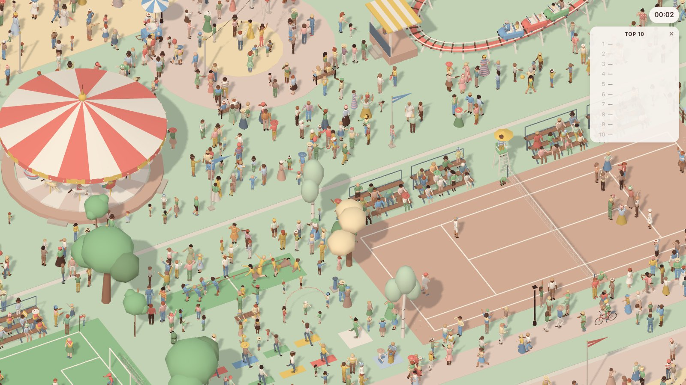

# Waldo Stripes Soft

A fully code-created 3D find-the-man-in-the-crowd game that runs on your own machine: a miniature
seaside festival town with twelve connected districts, about 10,700 animated people, 161 authored
little stories and thousands of procedural props, in a six-colour soft palette. There are no image
assets and no downloaded models. Every mesh, pattern and animation is generated from source.



You look down on the town at a fixed scale and pan around to find one man: striped shirt, bobble
hat, round glasses, blue trousers, walking stick. He is somewhere different on every visit and never
on the opening screen. The standard browser build plays without hints.

## Run it

You need [Node.js](https://nodejs.org) 22 (22.12 or newer), 24, or 26 and later.

```bash
npm install
npm run dev
```

Then open <http://127.0.0.1:5180>. To play the optimised build instead:

```bash
npm run build
npm run preview
```

and open <http://127.0.0.1:5181>.

Nothing is sent anywhere. The game makes no request to any other machine, and it has no accounts,
analytics or advertising. The one link that leaves is **Share on X**, and only when you click it.

## Play

- **Start:** a small how-to-play card opens every visit. The clock starts when you press Start.
  Until then the town cannot be moved or clicked (the crowd keeps moving behind the card).
- **Look around:** drag, two-finger scroll, or arrow keys / WASD. There is no in-game zoom (browser
  zoom still works).
- **Guess:** click or tap the person you think is Waldo. Wrong guesses are counted. The clock stops
  when you find him.
- **New scene:** refresh the page. Every visit gets a fresh random seed, a varied arrangement and a
  new hiding place.

## Leaderboard

The **top ten** is always on screen in the top right corner, under the clock: one place per person
(their best time; usernames are compared without regard to letter case). It can be closed to a
small "Top 10" button. After finding Waldo, the card shows your time and asks for a username to
save it under.

Saved times live in one file on your machine, `data/leaderboard.json`. It is created on the first
save and git ignores it. The file is the board: delete it to clear the board, or edit it to remove
someone, and the change shows on the next page load with no restart. `npm run dev` and
`npm run preview` share the same file.

If the file is ever not a valid leaderboard file (a typing mistake while editing, say), the server
leaves it exactly as it is. It never overwrites, moves or deletes a file it does not understand.
The win card says the leaderboard is not available, the terminal names the file, and everything
works again as soon as the file is put right or removed.

| Setting | Effect |
| --- | --- |
| `WALDO_LEADERBOARD_FILE=friends.json` | keep the times in `data/friends.json` |
| `WALDO_LEADERBOARD_FILE=/some/where/times.json` | keep them in a file anywhere else (an absolute path) |
| `WALDO_LEADERBOARD_FILE=:memory:` | keep them only until the server stops |

The times are whatever the browser reports. They are checked for plausibility (2 seconds to
6 hours, whole milliseconds, a clean username) but anyone at the keyboard can post a made-up time,
and the developer switches below show where Waldo is. This is a board for you and the people you
hand the laptop to, not a competition.

### TapTap H5 leaderboard

`npm run build:taptap` builds the H5 package in `dist-taptap/` with relative asset URLs.
The build defaults to `TAPTAP_LEADERBOARD_ID_PLACEHOLDER`. To build with your TapTap board ID:

```bash
VITE_TAPTAP_LEADERBOARD_ID=your_leaderboard_id npm run build:taptap
```

Create a public, permanent leaderboard in the TapTap developer console. Set the score to a
numeric integer (milliseconds), sort ascending, and retain the best score. Upload the H5 build
and verify it in the TapTap client with a test account. The H5 win card automatically submits the
run if no hints were used, shows your best time and rank, and opens TapTap's leaderboard. The
placeholder and ordinary browsers show an availability message. Play and the run result continue
if the board is unavailable. Choose **再玩一局** after a result to start a new puzzle in the same town.

### TapTap rewarded hints

The H5 build defaults to `TAPTAP_REWARDED_AD_UNIT_ID_PLACEHOLDER`, which hides the ad entry.
To enable live ads, create a rewarded-video placement in the TapTap developer console and build with:

```sh
VITE_TAPTAP_REWARDED_AD_UNIT_ID=your_ad_unit_id npm run build:taptap
```

Include `VITE_TAPTAP_LEADERBOARD_ID` in the same build to enable the leaderboard. Upload the output
and check live playback, completion and cancellation in the TapTap client. To exercise the UI
locally with the placeholder, run `npm run dev -- --mode taptap` and open `/?mockAds=1`.
The localhost simulator bypasses the 60-second grace period and offers complete, early-close and
failure outcomes.

The first hint encloses about 96 stationary candidates. Each additional hint drops about half
until the area contains at most eight candidates. The following reward marks Waldo. Completed
ads grant a hint and turn the puzzle into a practice result. Restarts preserve the puzzle's
hints, while a new puzzle starts with a fresh score. The H5 build emits local `waldo:ad-metric`
events for the hint funnel and run outcomes. Connect a collector before using those events for
production reporting.

## Security

The game is built to be run on the machine you play it on, and the defaults reflect that:

- **This machine only.** Both servers listen on `127.0.0.1`. Other devices on your network cannot
  reach them.
- **Other websites cannot use your board.** A page from another site, open in the same browser,
  could try to call a server on your machine. The leaderboard refuses every request that a browser
  marks as coming from another site's page (`server/leaderboard/origin.ts`), the server gives no
  other origin permission to read its answers, and it does not answer under any other host name.
- **Everything received is treated as untrusted.** Submissions are validated with zod, limited to
  1 KB and rate-limited. Usernames are cleaned of control characters, invisible characters and
  angle brackets, and are only ever put on the page as text. The saved-times file is checked the
  same way every time it is read.
- **The page loads only its own files.** A content security policy forbids outside scripts, frames
  and requests (`vite.config.ts`).
- **No secrets.** The project has no API keys, tokens or accounts, and needs none.
- **Sharing gives nothing away.** The Share on X text holds your time and nothing else. A link to
  the game is only added when the game is on a public address, never for this machine or a home
  network.

If you change `HOST` in `vite.config.ts` or put the game on a public server, you are outside what
this setup was designed for. The rate limits assume one trusted machine, the leaderboard has no
moderation tools, and you would need to serve the page over HTTPS and decide who may save times.
The developer switches turn themselves off on any host that is not local.

Found a security problem? Please open an issue, or contact the maintainer privately if it should
not be public yet.

## Develop

```bash
npm test                          # unit tests: generation, placement, clips, props, leaderboard
npx playwright install chromium   # once
npm run test:e2e                  # gameplay tests against the production build, headless
npm run typecheck
```

The gameplay tests start their own server on port 5182 with an in-memory leaderboard, so they never
add test names to your saved times.

Developer switches in the address work on localhost only: `?dev` installs inspection hooks on
`window.__waldo`, `?seed=anything` reproduces a scene, `?quality=low|medium|high` pins the render
quality, and `?noStatics=1`, `?noCrowd=1` and similar isolate parts of the render
(`src/dev/debugParams.ts`, `src/main.ts`).

```bash
node scripts/bench.mjs http://127.0.0.1:5181 60 bench-2 desktop   # frame pacing (needs `npm run preview`)
npm run zfight -- seed-a seed-b                                   # coincident surfaces that would flicker
```

The benchmark opens a browser window and writes its results to `bench-results/`. Measured numbers,
method and caveats are in [PERFORMANCE.md](PERFORMANCE.md).

## How it is built

TypeScript (strict), [Three.js](https://threejs.org) and [Vite](https://vite.dev). No framework.

| Area | Where | Notes |
| --- | --- | --- |
| Geometry kit | `src/core/geo.ts` | Immutable vertex-coloured meshes; `detail()` / `farOnly()` tag level of detail |
| Palette | `src/core/palette.ts` | The six colour tokens plus controlled light/shade derivations |
| Prop libraries | `src/props/*` | About 730 registered props and parametric builders (houses, stalls, bridges, rides, boats, trees…) |
| Crowd | `src/crowd/*` | One GPU-posed rig, 291 baked clips, about 280 wearable/holdable options, analytic motion |
| World | `src/world/*` | Town plan, district authoring kit, static batching, moving props, density pass, depth separation |
| Districts | `src/world/districts/*` | One authored module per district (stories, routes, staging) |
| Game | `src/game/*` | Seeded composition, hero placement verified against the render, GPU picking |
| Rendering | `src/render/*` | Engine loop, orthographic pan camera, shared world material |
| HUD | `src/ui/*` | Clock, how-to-play card, win card, corner leaderboard |
| Leaderboard contract | `shared/leaderboard.ts` | Types, limits, name cleaning and ordering used by browser and server |
| Leaderboard server | `server/leaderboard/*` | Request handling, validation, rate limits, the saved-times file, the Vite plugin that mounts it |
| Dev tools | `src/dev/devTools.ts` | Only with `?dev` on localhost: counts, picking probes, benchmark (`?dev=free` adds a free camera) |

### Tuning notes

- Game scale: `basePpm()` in `src/game/composition.ts` (34 px per metre on desktop, less on phones).
- Crowd density top-up: `FILL_DENSITY` in `src/world/town.ts`.
- Quality is locked to medium (`Engine` in `src/render/engine.ts`); `?quality=low|high` overrides it
  for measurements.
- Hero fairness thresholds (`MIN_VISIBLE`, `MIN_HEAD_VISIBLE`, `MIN_COMPANY`) are in
  `src/game/game.ts`: a hiding place is only accepted if his body and head are measurably visible in
  the id buffer and he stands on supported ground among other people.

## Known limitations

- The HUD is intentionally minimal: there are no on-screen pause, reduced-motion or quality
  controls. Pause and reduced motion are implemented and tested through the game API. The game
  always starts fully animated: it does not switch to reduced motion from the OS setting, because
  the overlay offers no way to switch it back.
- Performance was measured on one machine (Apple M3, Chromium). See PERFORMANCE.md for what was and
  was not verified. A GPU is expected; software rendering will be slow.
- A few authored details may show small placement flaws (props slightly floating or intersecting).
  The districts were spot-checked, not exhaustively inspected.

## License

[MIT](LICENSE).

This is an independent fan project. It is not affiliated with, endorsed by or connected to the
owners or publishers of *Where's Wally?* / *Where's Waldo?*.
